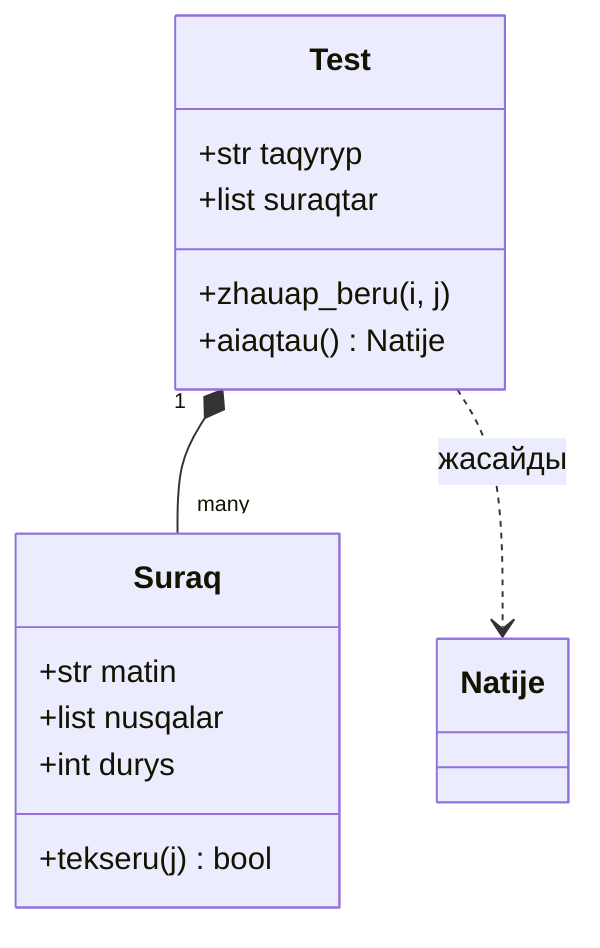

# Сабақ 90. Жоба архитектурасын жобалау. Модульдер мен кластарға бөлу.

## Тақырыптар

1. Архитектура деген не
2. Үш қабатты архитектура
3. Модульдер мен пакеттер
4. Жақсы архитектураның принциптері
5. Кластарды қалай табамыз
6. Кластар арасындағы байланыстар
7. Үлгі: жоба қаңқасы
8. Архитектуралық құжат (`docs/architecture.md`)
9. Жиі кездесетін қателер
10. Негізгі ұғымдар

## 1. Архитектура деген не

**Бағдарлама архитектурасы** — бағдарламаның негізгі бөліктері (модульдер, кластар), олардың әрқайсысының міндеті және бір-бірімен байланысы.

Аналогия — **мейрамхана**:

| Мейрамхана | Бағдарлама |
|---|---|
| Даяшы — қонақпен сөйлеседі, тапсырыс алады, тағамды әкеледі | **Интерфейс қабаты** (Tkinter / Pygame / консоль) |
| Аспаз — тағамды дайындайды, рецептті біледі | **Логика қабаты** (кластар, есептеулер, ережелер) |
| Қойма — азық-түлікті сақтайды | **Деректер қабаты** (SQLite, JSON, CSV, API) |

Даяшы қоймаға кірмейді, қонақ ас үйге кірмейді. Әр бөлік **өз жұмысын** істейді және көршісімен **келісілген тәсілмен** сөйлеседі. Қойманы ауыстырсақ (JSON → SQLite), даяшы мұны байқамайды.

## 2. Үш қабатты архитектура

```text
┌──────────────────────────────────────────────┐
│  ИНТЕРФЕЙС (UI)          gui.py              │  батырмалар, терезелер, енгізу/шығару
│  тек көрсетеді және пайдаланушыдан алады      │
└──────────────────────┬───────────────────────┘
                       │ шақырады
┌──────────────────────▼───────────────────────┐
│  ЛОГИКА (models / services)   models.py,     │  кластар, ережелер, есептеулер
│  интерфейс пен деректер қорын білмейді        │  stats.py
└──────────────────────┬───────────────────────┘
                       │ шақырады
┌──────────────────────▼───────────────────────┐
│  ДЕРЕКТЕР (storage)       storage.py         │  SQLite / JSON / CSV / API
│  тек сақтайды және оқиды                      │
└──────────────────────────────────────────────┘
```

**Тәуелділік бағыты — жоғарыдан төмен.** Интерфейс логиканы шақырады, логика деректер қабатын шақырады. Керісінше — ешқашан: `storage.py` ішінде `messagebox` болмауы керек, `models.py` ішінде `tkinter` импортталмайды.

**Неге бұл маңызды:**
- логиканы интерфейссіз **тестілеуге** болады (`unittest` терезе ашпайды);
- интерфейсті ауыстыруға болады (Tkinter → консоль → болашақта веб) — логика өзгермейді;
- деректер қорын ауыстыруға болады (JSON → SQLite) — тек `storage.py` өзгереді;
- әр файл қысқа әрі түсінікті; қате іздеу оңай (қате графикте ме — `stats.py`).

## 3. Модульдер мен пакеттер

**Модуль** — бір `.py` файл. **Пакет** — ішінде `__init__.py` файлы бар папка (бірнеше модульді біріктіреді).

### Ұсынылатын папка құрылымы

```text
ubt-trainer/
├── main.py              ← кіру нүктесі: барлық бөлікті «жинап», іске қосады
├── app/
│   ├── __init__.py      ← app — пакет (файл бос болуы мүмкін)
│   ├── models.py        ← логика: Suraq, Test, Natije кластары
│   ├── storage.py       ← деректер: Database класы (SQLite)
│   ├── stats.py         ← талдау: Pandas, Matplotlib
│   └── gui.py           ← интерфейс: Tkinter терезелері
├── data/
│   └── questions.csv    ← бастапқы деректер
├── tests/
│   ├── __init__.py
│   ├── test_models.py
│   └── test_storage.py
├── docs/
│   ├── idea.md
│   ├── TT.md
│   └── architecture.md  ← архитектура сипаттамасы
├── requirements.txt
├── .gitignore
└── README.md
```

### Импорт

```python
# main.py ішінде
from app.models import Test
from app.storage import Database
```

`if __name__ == "__main__":` — файл тікелей іске қосылғанда ғана орындалатын код; басқа модуль импорттағанда орындалмайды. Әр модульдің соңында оны «өз-өзін тексеру» үшін қолдануға болады.

**Ойын жобасы** (Pygame) үшін құрылым ұқсас: `main.py` (ойын циклі), `app/sprites.py` (Player, Enemy, Bullet кластары), `app/levels.py` (деңгейлер), `app/storage.py` (рекордтар JSON), `app/settings.py` (тұрақтылар: экран өлшемі, түстер, FPS), `assets/` (суреттер, дыбыстар).

## 4. Жақсы архитектураның принциптері

| Принцип | Мағынасы | Мысал |
|---|---|---|
| **Жауапкершілікті бөлу** (separation of concerns) | Әр модуль — бір сала | `storage.py` тек дерекпен жұмыс істейді |
| **Жалғыз жауапкершілік** (single responsibility) | Әр класс/функция — бір міндет | `Test` тест жүргізеді, бірақ графикті салмайды |
| **Ішкі байланыстылық жоғары, сыртқы тәуелділік төмен** (high cohesion, low coupling) | Модуль ішіндегі бөліктер тығыз байланысты; модульдер бір-біріне аз тәуелді | `gui.py` деректер қорының кестелерін білмейді |
| **DRY** (Don't Repeat Yourself) | Қайталамау | Бір SQL-ды 5 жерде жазбай, `Database` әдісіне шығару |
| **KISS** (Keep It Simple) | Қарапайым шешім | 3 класс жеткілікті болса, 10 класс жасамау |
| **YAGNI** (You Aren't Gonna Need It) | «Кейін керек болар» деп артық жасамау | ТТ-да жоқ «плагиндер жүйесі» |

## 5. Кластарды қалай табамыз

### «Зат есім — етістік» талдауы

ТТ-дағы user story-лерді оқып:
- **зат есімдер** → кластар немесе атрибуттар;
- **етістіктер** → әдістер.

US-1: «Мен **оқушы** ретінде **тақырыпты** *таңдап*, 10 **сұрақтан** тұратын **тест** *тапсырғым* келеді».
US-2: «... тест аяқталғанда **дұрыс және қате жауаптарымды** *көргім* келеді».
US-3: «... тақырыптар бойынша **нәтижелерімнің** **графигін** *көргім* келеді».

| Зат есім | Шешім | Неге |
|---|---|---|
| Сұрақ | **Класс** `Suraq` | Өз деректері (мәтін, нұсқалар, дұрыс жауап, тақырып) және әрекеті (жауапты тексеру) бар |
| Тест | **Класс** `Test` | Сұрақтар тізімі, ағымдағы сұрақ, жауаптар; әрекеттері — жауап беру, аяқтау |
| Нәтиже | **Класс** `Natije` | Күні, тақырып, балл; пайызды есептеу |
| Тақырып | Атрибут (`str`) | Өз әрекеті жоқ — жай мән |
| Оқушы | Атрибут (`str`, аты) | MVP-де бір пайдаланушы; Won't: көп пайдаланушы |
| График | Функция (`stats.py`) | Класс қажет емес (KISS) |
| Деректер қоры | **Класс** `Database` | Байланыс (күй) сақтайды; көп әдіс |

**Етістіктер → әдістер:** тапсыру → `Test.zhauap_beru()`, тексеру → `Suraq.tekseru()`, аяқтау → `Test.aiaqtau()`, сақтау → `Database.natije_saqtau()`, көрсету → `stats.taqyryp_grafigi()`.

### CRC карточкалары

Әр класқа бір стикер (Class — Responsibilities — Collaborators):

```text
┌───────────────────────────────────────────┐
│ Класс: Test                               │
├──────────────────────────┬────────────────┤
│ Жауапкершілігі           │ Серіктестері   │
│ - сұрақтарды сақтау      │ Suraq          │
│ - келесі сұрақты беру    │ Natije         │
│ - жауаптарды тіркеу      │                │
│ - нәтижені есептеу       │                │
└──────────────────────────┴────────────────┘
```

Жауапкершіліктер 5–6-дан асса — класты бөлу керек.

## 6. Кластар арасындағы байланыстар

| Байланыс | Мағынасы | Мысал | Кодта |
|---|---|---|---|
| **Композиция** («...тұрады») | Бір объект басқаларды ішінде ұстайды | `Test` бірнеше `Suraq`-тан тұрады | `self.suraqtar = [...]` |
| **Мұрагерлік** («...түрі болып табылады») | Ұрпақ класс ата-класты кеңейтеді | `TaimerTest` — `Test`-тің түрі | `class TaimerTest(Test):` |
| **Тәуелділік** («...пайдаланады») | Бір класс басқасын уақытша қолданады | `Test.aiaqtau()` `Natije` жасайды | әдіс ішінде `Natije(...)` |

**Ереже:** мұрагерлікті тек шын «...түрі болып табылады» қатынасында қолданыңыз. «`Database` — `Test`-тің түрі ме?» — жоқ, сондықтан мұрагерлік емес.

### Класс диаграммасы

```text
┌─────────────────────┐ 1      * ┌─────────────────────┐
│ Test                │◆─────────│ Suraq               │
├─────────────────────┤          ├─────────────────────┤
│ taqyryp: str        │          │ matin: str          │
│ suraqtar: list      │          │ nusqalar: list[str] │
│ zhauaptar: dict     │          │ durys: int          │
├─────────────────────┤          │ taqyryp: str        │
│ zhauap_beru(i, j)   │          ├─────────────────────┤
│ aiaqtau() -> Natije │          │ tekseru(j) -> bool  │
└─────────┬───────────┘          └─────────────────────┘
          │ жасайды
┌─────────▼───────────┐          ┌─────────────────────┐
│ Natije              │          │ Database            │
├─────────────────────┤          ├─────────────────────┤
│ taqyryp: str        │          │ path: str           │
│ durys: int          │          ├─────────────────────┤
│ barlygy: int        │          │ suraqtar_alu(t)     │
│ kuni: str           │          │ natije_saqtau(n)    │
├─────────────────────┤          │ natijeler_alu()     │
│ paiyz() -> int      │          └─────────────────────┘
└─────────────────────┘
◆── композиция (Test сұрақтардан тұрады), 1..* — «бір тестте көп сұрақ»
```

GitHub README-де **Mermaid** тілімен жазылған диаграмманы автоматты түрде сурет етіп көрсетеді:

````markdown

````

## 7. Үлгі: жоба қаңқасы

Архитектураны **кодтың қаңқасы** түрінде бекітеміз: кластар, атрибуттар, әдістердің атаулары мен docstring-тері — ішкі логикасы әзірге қарапайым немесе `NotImplementedError`. Содан кейін қаңқа біртіндеп жұмыс істейтін кодпен толтырылады.

**`app/models.py`** — логика (Tkinter мен SQLite-ты білмейді):

```python
"""Тренажердің негізгі кластары: сұрақ, тест, нәтиже."""

from datetime import date


class Suraq:
    """Бір таңдаулы жауабы бар тест сұрағы."""

    def __init__(self, matin, nusqalar, durys, taqyryp):
        self.matin = matin
        self.nusqalar = nusqalar
        self.durys = durys          # дұрыс нұсқаның индексі (0..3)
        self.taqyryp = taqyryp

    def tekseru(self, tandau):
        """Таңдалған нұсқа дұрыс болса True қайтарады."""
        return tandau == self.durys


class Natije:
    """Бір тесттің нәтижесі."""

    def __init__(self, taqyryp, durys, barlygy, kuni=None):
        self.taqyryp = taqyryp
        self.durys = durys
        self.barlygy = barlygy
        self.kuni = kuni or date.today().isoformat()

    def paiyz(self):
        """Дұрыс жауаптар пайызы (бүтін сан)."""
        return self.durys * 100 // self.barlygy if self.barlygy else 0


class Test:
    """Бір тақырып бойынша тест: сұрақтар және оқушы жауаптары."""

    def __init__(self, taqyryp, suraqtar):
        self.taqyryp = taqyryp
        self.suraqtar = suraqtar
        self.zhauaptar = {}         # {сұрақ индексі: таңдалған нұсқа}

    def zhauap_beru(self, suraq_index, tandau):
        """Оқушының жауабын тіркейді."""
        self.zhauaptar[suraq_index] = tandau

    def aiaqtau(self):
        """Тестті аяқтап, Natije объектісін қайтарады."""
        durys = sum(1 for i, s in enumerate(self.suraqtar)
                    if s.tekseru(self.zhauaptar.get(i, -1)))
        return Natije(self.taqyryp, durys, len(self.suraqtar))
```

**`app/storage.py`** — деректер (Tkinter-ді білмейді):

```python
"""SQLite деректер қорымен жұмыс."""

import sqlite3


class Database:
    """Сұрақтар мен нәтижелерді сақтайтын деректер қоры."""

    def __init__(self, path="data/trainer.db"):
        self.conn = sqlite3.connect(path)
        self.conn.execute(
            "CREATE TABLE IF NOT EXISTS natijeler ("
            "id INTEGER PRIMARY KEY, taqyryp TEXT, durys INTEGER, "
            "barlygy INTEGER, kuni TEXT)"
        )

    def natije_saqtau(self, natije):
        """Natije объектісін деректер қорына жазады."""
        self.conn.execute(
            "INSERT INTO natijeler (taqyryp, durys, barlygy, kuni) VALUES (?, ?, ?, ?)",
            (natije.taqyryp, natije.durys, natije.barlygy, natije.kuni),
        )
        self.conn.commit()

    def natijeler_alu(self):
        """Барлық нәтижені (taqyryp, durys, barlygy, kuni) тізімі ретінде қайтарады."""
        return self.conn.execute(
            "SELECT taqyryp, durys, barlygy, kuni FROM natijeler"
        ).fetchall()

    def suraqtar_alu(self, taqyryp):
        """Тақырып бойынша сұрақтарды қайтарады (әзірге жүзеге асырылмаған)."""
        raise NotImplementedError

    def zhabu(self):
        """Байланысты жабады."""
        self.conn.close()
```

**`main.py`** — кіру нүктесі: бөліктерді байланыстырады. Әзірге интерфейс орнына қарапайым тексеру:

```python
"""Бағдарламаның кіру нүктесі."""

from app.models import Suraq, Test
from app.storage import Database


def main():
    """Бөліктерді біріктіріп, қысқа демонстрация жасайды."""
    suraqtar = [
        Suraq("2 + 2 · 2 = ?", ["8", "6", "4", "2"], 1, "Арифметика"),
        Suraq("10 % 3 = ?", ["1", "3", "0", "10"], 0, "Арифметика"),
    ]
    test = Test("Арифметика", suraqtar)
    test.zhauap_beru(0, 1)
    test.zhauap_beru(1, 2)
    natije = test.aiaqtau()
    print(f"{natije.taqyryp}: {natije.durys}/{natije.barlygy} ({natije.paiyz()}%)")

    db = Database(":memory:")
    db.natije_saqtau(natije)
    print(db.natijeler_alu())
    db.zhabu()


if __name__ == "__main__":
    main()
```

Нәтижесі (күні өзгеше болады):
```text
Арифметика: 1/2 (50%)
[('Арифметика', 1, 2, '2027-04-13')]
```

Байқаңыз: интерфейс әлі жоқ, бірақ логика мен деректер қабаты **жұмыс істейді және тестіленеді**. `gui.py` кейін дәл осы `Test` пен `Database`-ті шақырады.

## 8. Архитектуралық құжат (`docs/architecture.md`)

Құрамы:
1. **Қабаттар мен модульдер** — кесте: файл → міндеті → кімді шақырады.
2. **Класс диаграммасы** (мәтіндік, Mermaid немесе draw.io суреті).
3. **Әр класс** — 1–2 сөйлем жауапкершілігі, негізгі атрибуттар мен әдістер.
4. **Негізгі сценарий** — бір user story-дің кодтағы жолы: «Пайдаланушы "Бастау" батырмасын басады → `gui` → `Database.suraqtar_alu()` → `Test(...)` → ... → `Database.natije_saqtau()`».
5. **Сыртқы тәуелділіктер** — кітапханалар (`requirements.txt`).

## Жиі кездесетін қателер

**1. «Құдай-класс»** — бәрін істейтін бір `App` класы (500 жол, 40 әдіс). Жауапкершіліктерді бөліңіз.

**2. Қабаттарды араластыру.**
```python
import sqlite3
from tkinter import messagebox


class Suraq:
    def tekseru(self, tandau):
        if tandau != self.durys:
            messagebox.showerror("Қате", "Жауап қате!")          # логика интерфейсті біледі
        sqlite3.connect("db.db").execute("INSERT ...")           # логика SQL жазады
```
Дұрысы: `tekseru` тек `True/False` қайтарады; хабарды `gui.py` көрсетеді, сақтауды `Database` жасайды.

**3. Мұрагерлікті орынсыз қолдану.** `class Database(Test)` — «деректер қоры тесттің түрі емес». Мұнда тек тәуелділік/композиция.

**4. Циклдік импорт.** `models.py` `gui.py`-ді, ал `gui.py` `models.py`-ді импорттаса — `ImportError`. Тәуелділік бағыты бір жақты болуы керек: `gui → models → (ештеңе)`.

**5. Тым ерте егжей-тегжей.** Архитектура кезеңінде әр әдістің ішін толық жазу қажет емес — атауы, параметрлері, docstring жеткілікті.

## Негізгі ұғымдар

| Ұғым | Түсіндірме |
|---|---|
| Архитектура | Бағдарламаның негізгі бөліктері, олардың міндеттері мен байланыстары |
| Қабат (layer) | Бір салаға жауапты бөліктер тобы: интерфейс, логика, деректер |
| Модуль / пакет | `.py` файл / `__init__.py` бар папка |
| Кіру нүктесі | Бағдарламаны іске қосатын файл (`main.py`) |
| CRC карточкасы | Класс — жауапкершіліктер — серіктестер |
| Композиция | «...тұрады» байланысы: объект ішінде басқа объектілер |
| Класс диаграммасы | Кластар мен байланыстардың сызбасы |
| Қаңқа (skeleton) | Кластар мен әдістердің атаулары бар, логикасы әзірге толмаған код |
| Low coupling / high cohesion | Модульдер арасы әлсіз тәуелді / модуль ішкі бөліктері тығыз байланысты |

## Ескерту

- Бағдарламаны жоба түбірінен іске қосыңыз (`python main.py` немесе `python -m app.gui`), сонда `from app.models import Test` түріндегі импорттар жұмыс істейді; басқа қалтадан `python app/gui.py` деп іске қосу жиі `ModuleNotFoundError` қатесіне әкеледі.
- Python 3.3-тен бастап `__init__.py` жоқ қалта да импортталады (namespace package), бірақ кәдімгі жоба үшін `__init__.py` файлын нақты жасаған дұрыс — құралдар (`unittest discover`, линтерлер) модульдерді сенімдірек табады.
- Циклдік импортты кейде `import`-ты функцияның ішіне көшіру арқылы айналып өтуге болады, бірақ дұрыс шешім — модульдер арасындағы тәуелділік бағытын қайта қарау.
- Деректері бар қарапайым кластар (`Natije`) үшін `@dataclass` декораторы ыңғайлы (`dataclasses` модулі, Python 3.7+): ол `__init__`, `__repr__` және `__eq__` әдістерін өзі жасайды.
- Тип аннотациялары (`def paiyz(self) -> int:`) іске қосу кезінде тексерілмейді, бірақ архитектураны түсініктірек етеді және кодты `mypy` құралымен тексеруге мүмкіндік береді.
- Құжаттама: [Modules](https://docs.python.org/3/tutorial/modules.html), [dataclasses](https://docs.python.org/3/library/dataclasses.html), [Mermaid class diagrams](https://mermaid.js.org/syntax/classDiagram.html).
