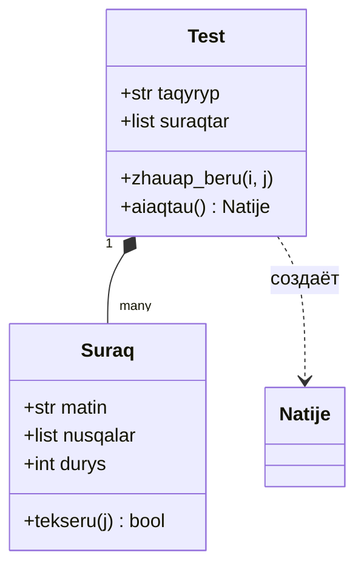

# Урок 90. Проектирование архитектуры проекта. Разделение на модули и классы.

## Темы

1. Что такое архитектура
2. Трёхслойная архитектура
3. Модули и пакеты
4. Принципы хорошей архитектуры
5. Как найти классы
6. Связи между классами
7. Пример: каркас проекта
8. Архитектурный документ (`docs/architecture.md`)
9. Частые ошибки
10. Основные понятия

## 1. Что такое архитектура

**Архитектура программы** — основные части программы (модули, классы), задача каждой из них и их связи друг с другом.

Аналогия — **ресторан**:

| Ресторан | Программа |
|---|---|
| Официант — общается с гостем, принимает заказ, приносит блюдо | **Слой интерфейса** (Tkinter / Pygame / консоль) |
| Повар — готовит блюдо, знает рецепт | **Слой логики** (классы, вычисления, правила) |
| Склад — хранит продукты | **Слой данных** (SQLite, JSON, CSV, API) |

Официант не ходит на склад, гость не заходит на кухню. Каждая часть делает **свою работу** и общается с соседом **согласованным способом**. Если заменить склад (JSON → SQLite), официант этого не заметит.

## 2. Трёхслойная архитектура

```text
┌──────────────────────────────────────────────┐
│  ИНТЕРФЕЙС (UI)          gui.py              │  кнопки, окна, ввод/вывод
│  только показывает и принимает ввод          │
└──────────────────────┬───────────────────────┘
                       │ вызывает
┌──────────────────────▼───────────────────────┐
│  ЛОГИКА (models / services)   models.py,     │  классы, правила, вычисления
│  не знает об интерфейсе и базе данных        │  stats.py
└──────────────────────┬───────────────────────┘
                       │ вызывает
┌──────────────────────▼───────────────────────┐
│  ДАННЫЕ (storage)         storage.py         │  SQLite / JSON / CSV / API
│  только сохраняет и читает                   │
└──────────────────────────────────────────────┘
```

**Направление зависимостей — сверху вниз.** Интерфейс вызывает логику, логика вызывает слой данных. Наоборот — никогда: внутри `storage.py` не должно быть `messagebox`, в `models.py` не импортируется `tkinter`.

**Почему это важно:**
- логику можно **тестировать** без интерфейса (`unittest` не открывает окна);
- интерфейс можно заменить (Tkinter → консоль → в будущем веб) — логика не меняется;
- базу данных можно заменить (JSON → SQLite) — меняется только `storage.py`;
- каждый файл короткий и понятный; ошибку искать легко (ошибка в графике — значит, `stats.py`).

## 3. Модули и пакеты

**Модуль** — один файл `.py`. **Пакет** — папка с файлом `__init__.py` внутри (объединяет несколько модулей).

### Рекомендуемая структура папок

```text
ubt-trainer/
├── main.py              ← точка входа: «собирает» все части и запускает
├── app/
│   ├── __init__.py      ← app — пакет (файл может быть пустым)
│   ├── models.py        ← логика: классы Suraq, Test, Natije
│   ├── storage.py       ← данные: класс Database (SQLite)
│   ├── stats.py         ← анализ: Pandas, Matplotlib
│   └── gui.py           ← интерфейс: окна Tkinter
├── data/
│   └── questions.csv    ← исходные данные
├── tests/
│   ├── __init__.py
│   ├── test_models.py
│   └── test_storage.py
├── docs/
│   ├── idea.md
│   ├── TT.md
│   └── architecture.md  ← описание архитектуры
├── requirements.txt
├── .gitignore
└── README.md
```

### Импорт

```python
# в main.py
from app.models import Test
from app.storage import Database
```

`if __name__ == "__main__":` — код, который выполняется только при прямом запуске файла; при импорте из другого модуля он не выполняется. Его можно использовать в конце каждого модуля для «самопроверки».

Для **игрового проекта** (Pygame) структура похожая: `main.py` (игровой цикл), `app/sprites.py` (классы Player, Enemy, Bullet), `app/levels.py` (уровни), `app/storage.py` (рекорды в JSON), `app/settings.py` (константы: размер экрана, цвета, FPS), `assets/` (изображения, звуки).

## 4. Принципы хорошей архитектуры

| Принцип | Значение | Пример |
|---|---|---|
| **Разделение ответственности** (separation of concerns) | Каждый модуль — одна область | `storage.py` работает только с данными |
| **Единственная ответственность** (single responsibility) | Каждый класс/функция — одна задача | `Test` проводит тест, но не рисует график |
| **Высокая связность внутри, слабая зависимость снаружи** (high cohesion, low coupling) | Части внутри модуля тесно связаны; модули мало зависят друг от друга | `gui.py` не знает таблиц базы данных |
| **DRY** (Don't Repeat Yourself) | Не повторяться | Не писать один SQL в 5 местах, а вынести в метод `Database` |
| **KISS** (Keep It Simple) | Простое решение | Не создавать 10 классов, если хватает 3 |
| **YAGNI** (You Aren't Gonna Need It) | Не делать лишнего «на будущее» | «Система плагинов», которой нет в ТЗ |

## 5. Как найти классы

### Анализ «существительное — глагол»

Читаем user story из ТЗ:
- **существительные** → классы или атрибуты;
- **глаголы** → методы.

US-1: «Как **ученик**, я хочу *выбрать* **тему** и *пройти* **тест** из 10 **вопросов**».
US-2: «... по окончании теста *видеть* свои **правильные и неправильные ответы**».
US-3: «... *видеть* **график** своих **результатов** по темам».

| Существительное | Решение | Почему |
|---|---|---|
| Вопрос | **Класс** `Suraq` | Есть свои данные (текст, варианты, правильный ответ, тема) и поведение (проверка ответа) |
| Тест | **Класс** `Test` | Список вопросов, текущий вопрос, ответы; действия — ответить, завершить |
| Результат | **Класс** `Natije` | Дата, тема, балл; вычисление процента |
| Тема | Атрибут (`str`) | Своего поведения нет — просто значение |
| Ученик | Атрибут (`str`, имя) | В MVP один пользователь; Won't: много пользователей |
| График | Функция (`stats.py`) | Класс не нужен (KISS) |
| База данных | **Класс** `Database` | Хранит соединение (состояние); много методов |

**Глаголы → методы:** пройти/ответить → `Test.zhauap_beru()`, проверить → `Suraq.tekseru()`, завершить → `Test.aiaqtau()`, сохранить → `Database.natije_saqtau()`, показать → `stats.taqyryp_grafigi()`.

### CRC-карточки

Для каждого класса — один стикер (Class — Responsibilities — Collaborators):

```text
┌───────────────────────────────────────────┐
│ Класс: Test                               │
├──────────────────────────┬────────────────┤
│ Ответственность          │ Партнёры       │
│ - хранить вопросы        │ Suraq          │
│ - выдавать след. вопрос  │ Natije         │
│ - фиксировать ответы     │                │
│ - вычислять результат    │                │
└──────────────────────────┴────────────────┘
```

Если обязанностей больше 5–6 — класс нужно разделить.

## 6. Связи между классами

| Связь | Значение | Пример | В коде |
|---|---|---|---|
| **Композиция** («...состоит из») | Один объект содержит внутри другие | `Test` состоит из нескольких `Suraq` | `self.suraqtar = [...]` |
| **Наследование** («...является разновидностью») | Дочерний класс расширяет родительский | `TaimerTest` — разновидность `Test` | `class TaimerTest(Test):` |
| **Зависимость** («...использует») | Один класс временно использует другой | `Test.aiaqtau()` создаёт `Natije` | `Natije(...)` внутри метода |

**Правило:** используйте наследование только при настоящем отношении «...является разновидностью». «`Database` — разновидность `Test`?» — нет, значит, это не наследование.

### Диаграмма классов

```text
┌─────────────────────┐ 1      * ┌─────────────────────┐
│ Test                │◆─────────│ Suraq               │
├─────────────────────┤          ├─────────────────────┤
│ taqyryp: str        │          │ matin: str          │
│ suraqtar: list      │          │ nusqalar: list[str] │
│ zhauaptar: dict     │          │ durys: int          │
├─────────────────────┤          │ taqyryp: str        │
│ zhauap_beru(i, j)   │          ├─────────────────────┤
│ aiaqtau() -> Natije │          │ tekseru(j) -> bool  │
└─────────┬───────────┘          └─────────────────────┘
          │ создаёт
┌─────────▼───────────┐          ┌─────────────────────┐
│ Natije              │          │ Database            │
├─────────────────────┤          ├─────────────────────┤
│ taqyryp: str        │          │ path: str           │
│ durys: int          │          ├─────────────────────┤
│ barlygy: int        │          │ suraqtar_alu(t)     │
│ kuni: str           │          │ natije_saqtau(n)    │
├─────────────────────┤          │ natijeler_alu()     │
│ paiyz() -> int      │          └─────────────────────┘
└─────────────────────┘
◆── композиция (Test состоит из вопросов), 1..* — «в одном тесте много вопросов»
```

GitHub автоматически показывает в README диаграмму, написанную на языке **Mermaid**, в виде рисунка:

````markdown

````

## 7. Пример: каркас проекта

Архитектуру закрепляем в виде **каркаса кода**: классы, атрибуты, имена методов и их docstring — внутренняя логика пока простая или `NotImplementedError`. Затем каркас постепенно заполняется рабочим кодом.

**`app/models.py`** — логика (не знает о Tkinter и SQLite):

```python
"""Основные классы тренажёра: вопрос, тест, результат."""

from datetime import date


class Suraq:
    """Тестовый вопрос с одним правильным ответом."""

    def __init__(self, matin, nusqalar, durys, taqyryp):
        self.matin = matin
        self.nusqalar = nusqalar
        self.durys = durys          # индекс правильного варианта (0..3)
        self.taqyryp = taqyryp

    def tekseru(self, tandau):
        """Возвращает True, если выбранный вариант правильный."""
        return tandau == self.durys


class Natije:
    """Результат одного теста."""

    def __init__(self, taqyryp, durys, barlygy, kuni=None):
        self.taqyryp = taqyryp
        self.durys = durys
        self.barlygy = barlygy
        self.kuni = kuni or date.today().isoformat()

    def paiyz(self):
        """Процент правильных ответов (целое число)."""
        return self.durys * 100 // self.barlygy if self.barlygy else 0


class Test:
    """Тест по одной теме: вопросы и ответы ученика."""

    def __init__(self, taqyryp, suraqtar):
        self.taqyryp = taqyryp
        self.suraqtar = suraqtar
        self.zhauaptar = {}         # {индекс вопроса: выбранный вариант}

    def zhauap_beru(self, suraq_index, tandau):
        """Фиксирует ответ ученика."""
        self.zhauaptar[suraq_index] = tandau

    def aiaqtau(self):
        """Завершает тест и возвращает объект Natije."""
        durys = sum(1 for i, s in enumerate(self.suraqtar)
                    if s.tekseru(self.zhauaptar.get(i, -1)))
        return Natije(self.taqyryp, durys, len(self.suraqtar))
```

**`app/storage.py`** — данные (не знает о Tkinter):

```python
"""Работа с базой данных SQLite."""

import sqlite3


class Database:
    """База данных для хранения вопросов и результатов."""

    def __init__(self, path="data/trainer.db"):
        self.conn = sqlite3.connect(path)
        self.conn.execute(
            "CREATE TABLE IF NOT EXISTS natijeler ("
            "id INTEGER PRIMARY KEY, taqyryp TEXT, durys INTEGER, "
            "barlygy INTEGER, kuni TEXT)"
        )

    def natije_saqtau(self, natije):
        """Записывает объект Natije в базу данных."""
        self.conn.execute(
            "INSERT INTO natijeler (taqyryp, durys, barlygy, kuni) VALUES (?, ?, ?, ?)",
            (natije.taqyryp, natije.durys, natije.barlygy, natije.kuni),
        )
        self.conn.commit()

    def natijeler_alu(self):
        """Возвращает все результаты в виде списка (taqyryp, durys, barlygy, kuni)."""
        return self.conn.execute(
            "SELECT taqyryp, durys, barlygy, kuni FROM natijeler"
        ).fetchall()

    def suraqtar_alu(self, taqyryp):
        """Возвращает вопросы по теме (пока не реализовано)."""
        raise NotImplementedError

    def zhabu(self):
        """Закрывает соединение."""
        self.conn.close()
```

**`main.py`** — точка входа: связывает части. Пока вместо интерфейса — простая проверка:

```python
"""Точка входа программы."""

from app.models import Suraq, Test
from app.storage import Database


def main():
    """Объединяет части и делает короткую демонстрацию."""
    suraqtar = [
        Suraq("2 + 2 · 2 = ?", ["8", "6", "4", "2"], 1, "Арифметика"),
        Suraq("10 % 3 = ?", ["1", "3", "0", "10"], 0, "Арифметика"),
    ]
    test = Test("Арифметика", suraqtar)
    test.zhauap_beru(0, 1)
    test.zhauap_beru(1, 2)
    natije = test.aiaqtau()
    print(f"{natije.taqyryp}: {natije.durys}/{natije.barlygy} ({natije.paiyz()}%)")

    db = Database(":memory:")
    db.natije_saqtau(natije)
    print(db.natijeler_alu())
    db.zhabu()


if __name__ == "__main__":
    main()
```

Результат (дата будет другой):
```text
Арифметика: 1/2 (50%)
[('Арифметика', 1, 2, '2027-04-13')]
```

Обратите внимание: интерфейса ещё нет, но слой логики и слой данных **работают и тестируются**. Потом `gui.py` будет вызывать именно эти `Test` и `Database`.

## 8. Архитектурный документ (`docs/architecture.md`)

Состав:
1. **Слои и модули** — таблица: файл → задача → кого вызывает.
2. **Диаграмма классов** (текстовая, Mermaid или рисунок draw.io).
3. **Каждый класс** — 1–2 предложения об ответственности, основные атрибуты и методы.
4. **Основной сценарий** — путь одной user story в коде: «Пользователь нажимает кнопку "Начать" → `gui` → `Database.suraqtar_alu()` → `Test(...)` → ... → `Database.natije_saqtau()`».
5. **Внешние зависимости** — библиотеки (`requirements.txt`).

## Частые ошибки

**1. «Божественный класс»** — один класс `App`, который делает всё (500 строк, 40 методов). Разделите ответственность.

**2. Смешивание слоёв.**
```python
import sqlite3
from tkinter import messagebox


class Suraq:
    def tekseru(self, tandau):
        if tandau != self.durys:
            messagebox.showerror("Ошибка", "Неверный ответ!")      # логика знает об интерфейсе
        sqlite3.connect("db.db").execute("INSERT ...")           # логика пишет SQL
```
Правильно: `tekseru` только возвращает `True/False`; сообщение показывает `gui.py`, сохранение выполняет `Database`.

**3. Неуместное наследование.** `class Database(Test)` — «база данных не является разновидностью теста». Здесь только зависимость/композиция.

**4. Циклический импорт.** Если `models.py` импортирует `gui.py`, а `gui.py` импортирует `models.py` — `ImportError`. Направление зависимостей должно быть односторонним: `gui → models → (ничего)`.

**5. Слишком ранняя детализация.** На этапе архитектуры не нужно полностью писать тело каждого метода — достаточно имени, параметров и docstring.

## Основные понятия

| Понятие | Объяснение |
|---|---|
| Архитектура | Основные части программы, их задачи и связи |
| Слой (layer) | Группа частей, отвечающих за одну область: интерфейс, логика, данные |
| Модуль / пакет | Файл `.py` / папка с `__init__.py` |
| Точка входа | Файл, запускающий программу (`main.py`) |
| CRC-карточка | Класс — обязанности — партнёры |
| Композиция | Связь «...состоит из»: другие объекты внутри объекта |
| Диаграмма классов | Схема классов и их связей |
| Каркас (skeleton) | Код с именами классов и методов, логика которых пока не заполнена |
| Low coupling / high cohesion | Слабая зависимость между модулями / тесная связь частей внутри модуля |

## Примечание

- Запускайте программу из корня проекта (`python main.py` или `python -m app.gui`), тогда импорты вида `from app.models import Test` работают; запуск `python app/gui.py` из другой папки часто приводит к `ModuleNotFoundError`.
- С Python 3.3 папка без `__init__.py` тоже импортируется (namespace package), но для обычного проекта файл `__init__.py` лучше создавать явно — так инструменты (`unittest discover`, линтеры) надёжнее находят модули.
- Циклический импорт иногда можно обойти, перенеся `import` внутрь функции, но правильное решение — пересмотреть направление зависимостей между модулями.
- Для простых классов с данными (`Natije`) удобен декоратор `@dataclass` (модуль `dataclasses`, Python 3.7+): он сам создаёт `__init__`, `__repr__` и `__eq__`.
- Аннотации типов (`def paiyz(self) -> int:`) не проверяются при запуске, но делают архитектуру понятнее и позволяют проверять код инструментом `mypy`.
- Документация: [Modules](https://docs.python.org/3/tutorial/modules.html), [dataclasses](https://docs.python.org/3/library/dataclasses.html), [Mermaid class diagrams](https://mermaid.js.org/syntax/classDiagram.html).
